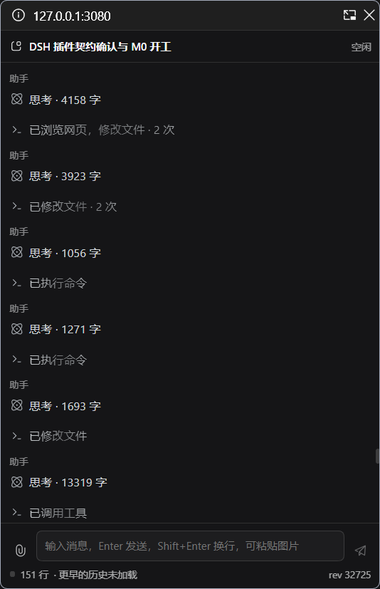

# dsh-pip-window

把 [DeepSeek Harness](https://www.deepseek.com/harness/) 的会话搬进一个**系统级置顶小窗**。

点侧边栏底部的「小窗」，当前会话就会在一个 [Document Picture-in-Picture](https://developer.mozilla.org/docs/Web/API/Document_Picture-in-Picture_API) 窗口里打开 —— 系统级浮窗，切到别的应用也一直在最上层，可以一边看 agent 干活一边做别的事，不用一直占着一个浏览器标签页。



## 特性

| 能力 | 说明 |
| --- | --- |
| **实时对话** | 直接读官方客户端服务 `ctx.sessions`，流式输出边生成边显示 |
| **可折叠的思考与工具行** | 「思考 · 402 字」「已搜索代码，浏览网页 · 3 次」，点开看细节，样式对齐主界面 |
| **发送与停止** | Enter 发送、Shift+Enter 换行；生成中按钮自动变成停止 |
| **发图片** | 点回形针选择，或直接 `Ctrl+V` 粘贴；支持 png / jpeg / webp / gif |
| **跟随会话** | 主界面切会话，小窗自动跟着切 |
| **主题与排版完全对标** | 开窗时把主文档的样式表、`--dsw-*` 变量、主题属性和字体一起搬过去，不是另画一套皮肤 |
| **侧边栏入口** | 展开与收起两种宽度都和「设置」对齐 |

## 安装

### 从 GitHub

```bash
dsh plugin --profile web add github:cyberbutterfly0/dsh-pip-window
```

### 从本地目录（开发时）

```bash
dsh plugin --profile web add link:/absolute/path/to/dsh-pip-window
```

装完**刷新页面**，侧边栏底部就会出现「小窗」。

### 桌面端

官方桌面端使用独立的 profile，需要单独装一次：

```bash
# 先启动一次桌面端，让它初始化 profile，然后完全退出
dsh plugin --profile desktop add github:cyberbutterfly0/dsh-pip-window
```

`desktop` profile 的包管理要用桌面端自带的那份 CLI（应用菜单里的「管理 dsh 命令…」可以注册）。

## 用法

1. 侧边栏底部点「小窗」，小窗打开后跟随当前会话
2. 输入框 Enter 发送、Shift+Enter 换行；点回形针或 `Ctrl+V` 加图片
3. 生成中按钮变成停止，点一下中断
4. 关掉小窗后，随时从侧边栏再开

## 已知限制

- **浏览器要求**：`documentPictureInPicture` 需要 Chrome / Edge **116+**、Firefox **151+**。**Safari 至今不支持**，各移动端浏览器也不支持。
- **需要安全上下文**：`https://`、`http://localhost` 或 `http://127.0.0.1` 才行。用局域网 IP（`http://192.168.x.x:3080`）打开时，浏览器根本不会暴露这个 API。
- **只对 Web 客户端生效**（`dsh.client.platform: "web"`）。
- **契约锚定 dsh `0.1.7-alpha.2`**：实现里用到了 `data-sidebar-collapsed` 属性、`--dsw-*` 变量、`localStorage` 的 `dsh.sessions.current` 这些内部细节，dsh 升级后可能需要跟改（最可能先坏的是窄栏对齐、主题搬运、会话跟随）。
- **发送与停止没有自动化测试**：一测就会往真实会话里塞消息，目前靠手动验证。

## 开发

**零构建**：`client.js` 是手写的 CJS 式 bundle，没有 JSX/TS，React 全部走 `createElement`。改完**刷新页面**即可生效（bundle URL 带内容 hash，不用重启 dsh，也不用重新 `dsh plugin add`）。

### 诊断日志

```js
// 打开
localStorage.setItem('dsh-pip-window:debug', '1')
// 关闭
localStorage.removeItem('dsh-pip-window:debug')
```

打开后重开小窗，控制台会打印两条诊断：

- `pip rows` —— 行数、阶段、流式正文字数与思考字数、最后一行摘要
- `pip dom` —— 小窗里**真实的 DOM 统计**（小窗是独立 document，主标签页的 devtools 看不到它）

### 文件

| 文件 | 作用 |
| --- | --- |
| `client.js` | 客户端半：开窗、搬运样式、渲染、收发消息 |
| `index.js` | Host 半：目前只做契约自检（数据全部走客户端服务，没有自建 HTTP 端点） |
| `cordis.patch.yml` | 往 profile 里插入插件行 |

## 许可

[MIT](LICENSE)
